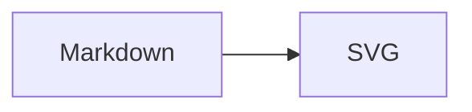

# docusaurus-theme-pele 與 Mermaid 遷移

`docusaurus-theme-pele` 是一個 Docusaurus theme，用 [Pele](https://pele.run) 取代 `@docusaurus/theme-mermaid` 來渲染 `mermaid` 圍欄區塊。它不是 Pele 的 fork，也不是新的圖表語法；Markdown 仍然寫 Mermaid，只是換掉瀏覽器端的 renderer。

## 為什麼換掉 Mermaid

| 項目 | Mermaid 11 | Pele |
| --- | --- | --- |
| 打包大小 | 約 790 KB gzip | 約 250 KB gzip（所有圖表類型） |
| 渲染方式 | 非同步初始化，有全域 singleton | 同步 `mount()`，沒有全域狀態 |
| 主題切換 | 通常需要重新渲染 | CSS 變數切換，不重繪 |
| 錯誤處理 | 解析錯誤可能留下 DOM 痕跡 | 錯誤顯示在容器內，不破壞頁面 |

實際數字以套件 README 為準；重點不是「Pele 一定比較好」，而是圖表數量與主題切換頻率，讓「小、同步、可用 CSS 改色」這三件事很有價值。

Pele 的輸出不會和 Mermaid 一模一樣。它支援 Mermaid 12.1 語法，但有自己的 layout 與視覺風格；如果站上有依賴 Mermaid 特定排版或 `%%{init}%%` 主題覆寫的圖，遷移前要先檢查。

## 安裝與設定

```bash
npm install docusaurus-theme-pele
```

如果 `package.json` 裡還有舊的 Mermaid theme 與相關套件，可以一起移除：

```bash
npm uninstall @docusaurus/theme-mermaid mermaid @mermaid-js/layout-elk
```

設定分成兩件事：讓 Docusaurus 把 `mermaid` 圍欄轉成 `<Mermaid>` 元件，以及把 `<Mermaid>` 換成 Pele 的實作。

```ts
// docusaurus.config.ts
export default {
  markdown: {
    mermaid: true,
  },
  themes: ['docusaurus-theme-pele'],
  themeConfig: {
    pele: {
      zoom: 'auto',
    },
  },
};
```

幾個容易踩到的點：

- `markdown.mermaid: true` 仍然要開；theme 只負責渲染，不負責把 fence 轉成元件。
- 不要再把 `@docusaurus/theme-mermaid` 放在 `themes`。Docusaurus 的 theme 是最後一個勝出；若真的得並存，`docusaurus-theme-pele` 要放在後面。
- `themeConfig.mermaid` 不會被使用，請改用 `themeConfig.pele`。
- 如果站上還有 `@mermaid-js/layout-elk`，Pele 不支援 ELK layout，應移除。

## 運作方式

Docusaurus 的 Mermaid 整合會把：

````md

````

轉成 `<Mermaid value="...">`。`docusaurus-theme-pele` 覆寫 `src/theme/Mermaid`，在這個元件裡動態載入 `pele`，再用 `mount(container, value, { zoom })` 渲染。

這個設計有幾個結果：

- **SSR 不產生 SVG**：靜態建置時只輸出空的 `.docusaurus-mermaid-container`，圖表在瀏覽器端掛載。這與 `@docusaurus/theme-mermaid` 現行行為一致。
- **renderer 不進初始 bundle**：`import('pele')` 是動態的，只有頁面真的出現圖表時才載入。
- **元件卸載會 destroy**：SPA 導覽切換頁面時不會留下舊的 diagram 實例。
- **主題切換不重繪**：Pele 的顏色來自 CSS 變數，Docusaurus 的 `--ifm-*` 改變時直接反映。

## 主題與 CSS 變數

Theme 會把 Pele 的變數對到 Docusaurus 的 `--ifm-*`，所以圖表會跟著站台配色與明暗模式走。需要微調時，直接覆寫 `.docusaurus-mermaid-container`：

```css
.docusaurus-mermaid-container {
  --pele-accent: #205ea6;
  --pele-radius: 8px;
}
```

也可以只針對單一張圖：

```ts
themeConfig: {
  pele: {
    className: 'my-diagram',
  },
},
```

```css
.my-diagram {
  --pele-accent: #b5651d;
}
```

Light mode 下，Pele 預設用 `--ifm-color-primary-darker` 當強調色，讓有色塊上的文字保持可讀；想要完全一致的品牌色再覆寫 `--pele-accent`。

## 選項

`themeConfig.pele` 目前只有兩個選項：

| 選項 | 型別 | 說明 |
| --- | --- | --- |
| `zoom` | `boolean \| 'auto' \| ZoomOptions` | 縮放控制；預設 `'auto'`，只有圖被縮小到容器內時才顯示 |
| `className` | `string` | 加在每個 diagram 容器上的額外 class |

`ZoomOptions` 可以控制 `always`、`maxScale`、`controls`、`labels`，細部欄位見 [Pele 文件](https://pele.run)。

## 相容性與限制

- **語法版本**：Pele 以 Mermaid 12.1 為目標；太新或 Mermaid 專屬的語法可能不支援。
- **視覺不同**：Pele 有自己的 layout 與配色邏輯，不要期待與 Mermaid 逐像素一致。
- **不支援 ELK**：`@mermaid-js/layout-elk` 的 layout 不會生效。
- **`%%{init}%%`**：部分 theme 覆寫會被忽略或只部分支援。
- **錯誤處理**：不合法的 Mermaid 會在圖表容器內顯示錯誤，不會讓整頁壞掉；瀏覽器 console 也會留下 parse error。
- **client render**：需要 JavaScript 才能看到圖；純靜態 HTML 只有空容器。

## 驗證方式

Fixture site 的 Playwright 測試固定檢查：

- 7 張圖都渲染成 `svg.pele`
- 寬圖有 2 個 zoom control
- zoom control 不與 SVG 重疊
- 切換 dark mode 後 `--pele-bg` 改變，圖表仍可見
- 沒有 page error

## 檢查清單

遷移一個站台時，建議依序確認：

1. `package.json` 是否還有 `@docusaurus/theme-mermaid`、`mermaid`、`@mermaid-js/layout-elk`。
2. `markdown.mermaid` 是否為 `true`。
3. `themeConfig.pele` 是否符合預期，尤其是 `zoom`。
4. build 後抽樣頁面是否出現 `svg.pele`。
5. 明暗模式切換是否正常。
6. 是否有依賴 ELK 或 `%%{init}%%` 的圖。

## 系列文章

- [[01 docusaurus-kit 專案總覽]]
- [[03 Obsidian 外掛 Kanban 與 Tasks]]
- [[04 GitHub Actions 與 npm 信任發佈]]
- [[05 開發測試與新增套件]]
- [[06 docusaurus-kit 版本與變更記錄]]

## 參考

- [docusaurus-theme-pele README](https://github.com/kywk/docusaurus-kit/tree/main/packages/theme-pele)
- [Pele 官方網站](https://pele.run)
- [Pele compatibility](https://pele.run/compatibility)
