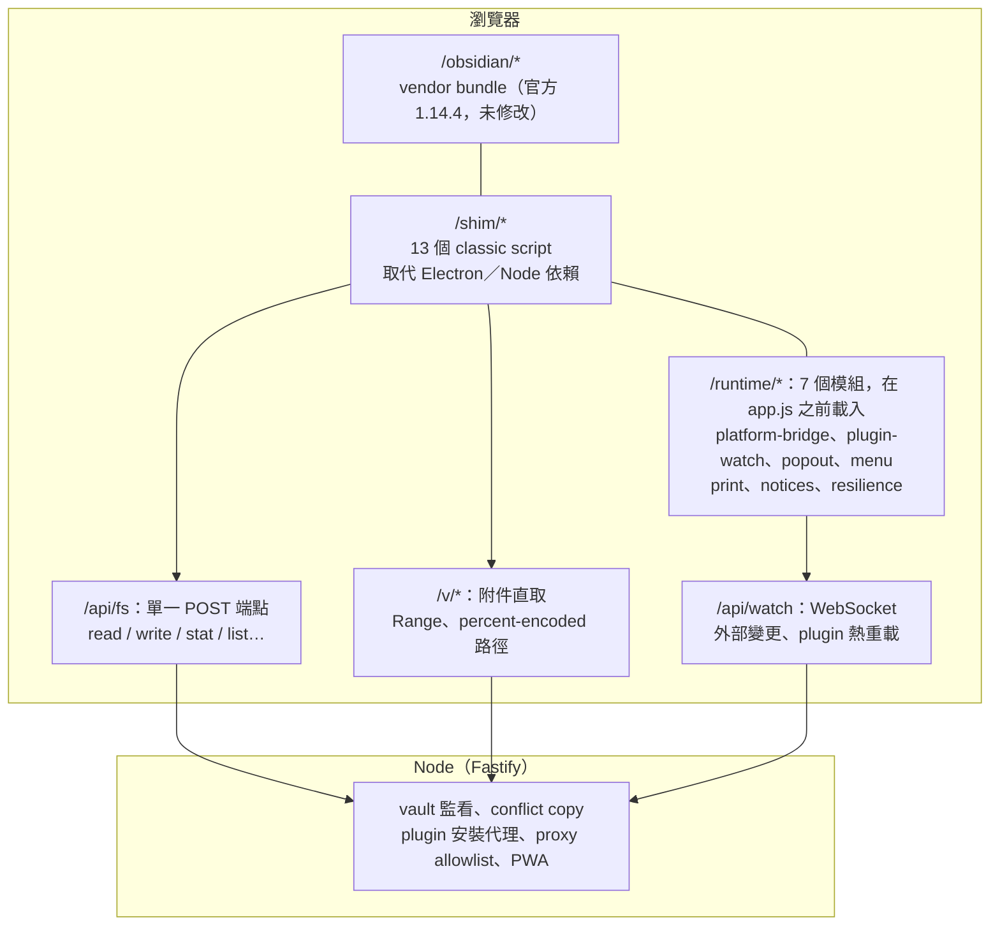

# 01 myObsidian 專案介紹

myObsidian 是一個自架服務：把指定 vault 變成可在瀏覽器存取與編輯的網頁應用，UI 與外掛生態跟桌面版同一套。

專案位置：[kywk/my-obsidian](https://github.com/kywk/my-obsidian)。

關鍵一句話：**跑的是你自己已安裝的 Obsidian 的 `app.js`（位元組與官方釋出檔一致），外面的 Electron／Node 依賴由 13 個 shim 取代。** 不是重寫的編輯器，也不是遠端桌面串流。

> **非官方專案，與 Obsidian 無任何隸屬、贊助或背書關係。** Obsidian 的程式碼、名稱與商標全部屬於其權利人。本專案不包含、不散布任何 Obsidian 程式碼，renderer 由你在自己的機器上從已安裝的官方 Obsidian 取得。設計給你自己在自己的機器、自己的 vault 使用；對他人提供服務需要 Obsidian 的明示同意。使用前請先備份 vault。

## 這是什麼／不是什麼

|  |  |
|---|---|
| **是** | 一個 Node 服務，把指定 vault 變成可在瀏覽器存取／編輯的網頁應用，UI 與外掛生態跟桌面版同一套 |
| **不是** | 重寫的 Markdown 編輯器；用 UI 框架拼出來的「類 Obsidian」；VNC 遠端桌面；Obsidian 官方產品 |

差別在於：你拿到的所有功能都是 Obsidian 自己的實作，我們只負責把宿主環境（檔案、選單、視窗、剪貼簿、列印、外掛載入）補起來。

## 為什麼做這個

[[Why n How Obsidian]] 已經說明選擇 Obsidian 的理由：本地儲存、Markdown 開放格式、豐富外掛、啟動快速。但桌面版 Obsidian 仍有兩個現實缺口：

1. **出門在外沒有自己的機器時看不到 vault。** [[Co-working Spark and Obsidian]] 討論的是讓 AI 經由 Dropbox 讀寫 vault，myObsidian 補的是另一半：讓人經由瀏覽器直接開 vault。
2. **團隊共筆沒有官方答案。** Obsidian Sync／Publish 是個人同步與發佈，不是多人即時共編（詳見 [[03 myObsidian 下一階段與多人共編]]）。

myObsidian 第一版先解決「個人在瀏覽器用到跟桌面版一樣的 Obsidian」，多人共編是下一階段的優先題目。

## 架構：三層，各司其職



幾個刻意的设计決定（完整 19 項見專案 `docs/DESIGN.md` §3）：

- **不上前端 bundler。** shim 必須在 Obsidian 的 `app.js` 之前以 classic script 生效。
- **`vendor/` 永不入版控。** 由 `npm run vendor` 在操作者機器上從已安裝的 Obsidian 解包取得。
- **零 renderer patch。** 所有平台行為在 runtime 以 shim 調整，`app.js` 保持位元組一致。
- **server 不執行任何 git 指令。** vault 可能同時被 Dropbox 與 git 管理，服務不做第三個競爭者。

## 第一次啟動會看到什麼

**同意畫面。** 它包含兩件事：

1. **逐項確認四個重點**：這是非官方專案、你接受 Obsidian 自己的條款、你只自用不對他人提供、軟體不附保證且風險自負。全部勾選前無法送出。
2. **貼上 renderer 要求的聲明字串。** Obsidian 1.13 之後的 renderer 會在啟動時向宿主索取一段聲明字串，逐字比對，不符就中止。本專案不內建該字串：畫面上會給你取出該字串的指令，由你貼上並確認。

確認後寫進 `~/.config/my-obsidian/config.json`（權限 0600），**立即生效，不需重啟**。在那之前 `/obsidian/app.js` 回 403。

完成後就是完整的 Obsidian。vault 裡只會多一個檔案：`.obsidian/workspace-server.json`（與桌面版的 `workspace.json` 分開存放，互不干擾）。

開發模式另有 `--dev`：跳過同意畫面，只允許 loopback，從 `vendor/obsidian/app.js` 讀出字串注入 renderer，不落盤、不輸出。這是給本專案開發者的捷徑，一般使用者走正常流程。

## 日常使用：三個行為要先知道

**外部變更會即時反映。** 雲端同步工具（Dropbox、iCloud 等）、另一台機器開著的 Obsidian、`git checkout`、手動編輯——服務啟動後就開始監看：筆記／附件走 Obsidian 內建的 reconcile；外掛 `main.js`／`manifest.json` 自動 unload → load；`workspace.json` 刻意忽略（版面由瀏覽器這一份掌管）。

**同時寫入同一檔案會產生衝突副本。** 例如桌面版與瀏覽器同時存檔，伺服器會把磁碟上的舊版本另存為 `<name>.conflict-<timestamp>.<ext>`，再寫入新版本，並在右下角跳通知。這是單一寫入者模型下的保底，不是共編合併。

**後端斷線時會明確失敗，不會假裝存好。** 服務重啟、筆電休眠、tunnel 斷線都會被偵測到：通知區出現離線提示，此時所有寫入會被擋下並回報「本次修改沒有存到磁碟」。服務回來後會自動重連，並把斷線期間的檔案變更加回畫面。

## 安全性（先讀完再對外開）

- **預設只綁 `127.0.0.1`。**
- 服務有 vault 的**完整讀寫權限**，而且會**執行 vault 裡的社群外掛程式碼**。`--host 0.0.0.0` 加上沒有 auth token，等於把整個 vault 交給任何能連到那個埠的人。
- `--auth-token` 是**單一共用 token**（cookie `myobs_token`），不是多使用者登入系統。
- `--dev` 只適用於本機，不要用反向代理把 dev mode 暴露出去。
- **TLS 由你負責**：放在反向代理（Caddy／nginx／Cloudflare Tunnel）後面。直接暴露在公網是不安全的。

## 快速開始（給想試的人）

```bash
# 0. 取得專案
git clone https://github.com/kywk/my-obsidian && cd my-obsidian

# 1. 安裝 server 依賴
npm --prefix packages/server ci

# 2. 取得 Obsidian renderer（從你已安裝的 Obsidian 自動偵測解包）
npm run vendor

# 3. 檢查環境（逐項告訴你缺什麼、要跑哪個指令）
npm run doctor -- --vault /path/to/your-vault

# 4. 啟動，開 http://127.0.0.1:3000/，依畫面完成確認
npm start -- --vault /path/to/your-vault
```

前置需求：macOS、已安裝官方 Obsidian 桌面版、Node.js 22+、一個 vault（或空目錄）。**先備份 vault，或先指向一份副本試用。**

## 相關文章

- [[02 myObsidian 第一版現況與驗收]]：第一版做到什麼、驗收數字、做不到什麼
- [[03 myObsidian 下一階段與多人共編]]：dogfooding、多人共編優先路線、團隊共筆之前要先解決的事
- [[Why n How Obsidian]]：為什麼選擇 Obsidian
- [[my Obsidian]]：目前個人 vault 的實際配置
- [[Co-working Spark and Obsidian]]：AI 經由雲端讀寫 vault 的架構（與瀏覽器存取互補）
- [[Obsidian Plugins Overview]]：外掛啟用狀況總覽（瀏覽器版的外掛相容性對照）
